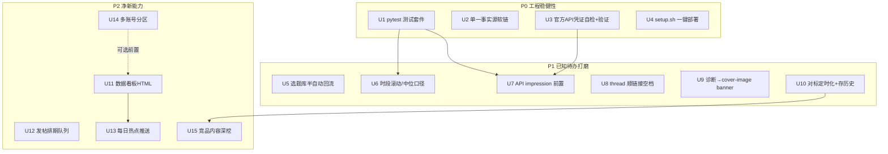

# feat: x-operation-skills 优化与增强路线图

分三阶段推进 x-operation-skills 这个「X 内容生成 + 运营包」的下一步：先补工程稳健性(P0),再打磨已知待办(P1),最后加净新能力(P2)。计划面向该仓库自身,不改动运营中的账号数据。

**Product Contract 说明**:无上游 brainstorm,直接从当前包状态 + `30-outputs/运营/X运营skill能力落地-2026-07-14.md` 的「下一步」清单 + 本 session 已知缺口 bootstrap 而来。

---

## Summary

当前包已可用(4 个运营 skill + 3 个内容生成 skill + 8 个脚本,cookie 路径实测跑通)。但有三类欠账:①**工程稳健性**——脚本零自动化测试、`content-generation/` 是本地镜像会漂移、官方 API 写路径从未真跑过;②**已知待办**——选题回环还是人工合并、时段分析被单帖爆款扭曲、de-ai 没顺 thread 链接空档等;③**净新能力**——数据看板、发帖排期、每日热点推送、多账号、竞品内容深挖。本计划把这三类拆成 15 个实现单元,按 P0→P1→P2 顺序落地。

---

## Problem Frame

- **谁**:包的维护者(用户本人),以及未来 clone 这个公开仓库的人。
- **痛点**:包能用但不「稳」——改脚本不敢重构(没测试兜底)、镜像会悄悄漂移、写功能不敢真发(没验证过)、有价值的分析结论还要手工搬运、有些结论会被极端值带偏。
- **边界**:只动 x-operation-skills 仓库(含本地 runner/plist);不改用户知识库结构,不动运营中的真实账号数据口径。个人写作系统仍留本地不进公开仓库。

---

## Requirements

- **R1** 脚本有可回归的自动化测试,重构/改口径后能一键验证不回归。
- **R2** `content-generation/` 与本地共享 skill 之间有单一事实源,不再手工 `cp -R` 导致漂移。
- **R3** 官方 API 读/写路径有凭证自检 + 真实验证状态标注,不再是"从没跑过"的黑盒。
- **R4** 一键部署:新机器能一条命令建 venv、装依赖、软链 skill,并被提示配 cookie/代理/凭证。
- **R5** 复盘结论能半自动回流选题库(A 级扩系列 / B 级换头重发),人只审核不搬运。
- **R6** 时段/类别结论抗单帖爆款扭曲(滚动/中位口径),样本不足显式标注。
- **R7** 有官方 API 凭证时,复盘默认用更准的 `impression_count`,而非 pulse 的公开 views。
- **R8** 内容生成链路顺畅:thread 拆分不留链接空档;账号诊断能直接产出新 banner。
- **R9** 对标追踪可定时化 + 存历史,看趋势不只单次快照。
- **R10** 数据看板:把 analysis JSON + 快照趋势渲染成可视化(本地 HTML),一眼看结构。
- **R11** 发帖排期:草稿进队列,按计划时间自动发(仍走 x-post 的确认/费用口径)。
- **R12** 每日热点推送:定时扫热点,过滤后弹通知或落草稿,不用手动喊。
- **R13** 多账号:脚本参数化 handle,数据目录按账号隔离。
- **R14** 竞品内容深挖:对标追踪从"只看指标"扩到"看内容主题/选题分布"。

---

## Key Technical Decisions

- **KTD1 测试框架用 pytest + 纯函数优先**:`analyze_x_data`/`split_thread`/`topic_feedback` 的核心是纯函数(输入 JSON/文本→输出),直接单测;`fetch_*` 的网络部分用 mock(twscrape/curl_cffi 的返回打桩),不打真实网络。测试放各 skill 的 `scripts/tests/`。理由:纯函数覆盖成本低、回归价值高;网络层 mock 避免测试依赖 cookie/代理。
- **KTD2 单一事实源:仓库为准,本地软链过去**。把 `~/.agent-harness/skills/{cover-image,xhs-title,xhs-keyword-strategy}` 改成软链指向仓库 `content-generation/` 副本(反转当前的"本地为源、仓库为镜像")。理由:仓库是公开可 clone 的发布物,应是权威;本地通过软链消费,消除漂移。需处理 sync-harness.sh 的交互(它做 Claude/Codex→共享目录的收拢)。
- **KTD3 数据源优先级改为:CSV(7天内) > API(有凭证) > pulse**。当前 analyze 已支持三模式,缺的是"有 API 凭证时自动优先"的调度。在 runner/skill 层做凭证探测,不在脚本里硬编码。
- **KTD4 看板用确定性 HTML 渲染,不引前端框架**。仿 cover-image 的思路:读 JSON → 生成自包含 HTML(内联 CSS + 轻量 SVG/表格),本机打开即看。理由:零依赖、可离线、与包"确定性、不联网"的风格一致。
- **KTD5 排期/热点推送复用 launchd + agent-runner 既有底座**,不自造调度。理由:粉丝快照、周报无人值守已验证这套底座可靠。
- **KTD6 多账号用数据目录分区**:`~/.local/share/x-operation-skills/<handle>/`。脚本已有 `X_SKILLS_DATA_DIR`,扩成按 handle 派生子目录即可,向后兼容单账号。

---

## Scope Boundaries

**本计划做**:P0 稳健性、P1 待办打磨、P2 净新能力,均限于 x-operation-skills 仓库与其本地 runner。

### Deferred to Follow-Up Work
- 个人写作系统(文风 DNA/镇库范文)进仓库——已定为个人 IP 留本地,不在本计划。
- 官方 API 的高级写操作(定时删帖、DM、媒体上传)——排期只做发帖,其余后续再说。
- 看板的多账号对比视图——先做单账号看板(U11),多账号对比留 U13/U14 之后。

### 非目标
- 不改用户知识库(`Documents/knowledge-base`)的目录结构或 Dataview 口径。
- 不做 X 官方 API 之外的自动化发布(不绕过确认门代替用户发)。
- 不引入需要长驻服务/数据库的架构(保持脚本 + launchd 的轻量形态)。

---

## High-Level Technical Design

三阶段依赖关系与数据流:

P0 是地基(测试和部署让后续改动安全);P1 依赖 P0 的测试兜底;P2 的看板/推送依赖 P1 的数据口径稳定。

---

## Implementation Units

### U1. pytest 测试套件(纯函数 + 网络 mock)

- **Goal**:给核心脚本建可回归测试,重构/改口径不怕回归。满足 R1。
- **Requirements**:R1
- **Dependencies**:无(最先做)
- **Files**:
  - `x-content-review/scripts/tests/test_analyze_x_data.py`(新建)
  - `x-content-review/scripts/tests/test_topic_feedback.py`(新建)
  - `x-post/scripts/tests/test_split_thread.py`(新建)
  - `x-content-review/scripts/tests/test_fetch_pulse_filter.py`(新建,mock)
  - `pytest.ini` 或 `pyproject.toml`(新建,配 testpaths)
- **Approach**:纯函数直接喂样例 JSON/文本断言输出;`fetch_recent_posts` 的作者过滤/去重逻辑抽到可测函数或用 mock 的 tweet 对象喂 `_should_keep`。twscrape/curl_cffi 不真实调用。
- **Patterns to follow**:脚本现有的纯函数边界(`weighted_len`/`pack_segments`/`classify_post`/`grade_post`/`compute_period_comparison`)。
- **Test scenarios**:
  - `split_thread`:纯中文超 270 加权长度→按句界拆多条,每条 ≤270;含 2 链接→归末条自回复且费用 $0.20+2×$0.015;单句超长→硬切在空格。
  - `analyze_x_data`:pulse 模式类别效率计算正确;`compute_period_comparison` 本期/上期切分按发布日正确;样本不足时段标记。
  - `topic_feedback`:A 级帖→扩系列块;B 级→换头重发块;无 A/B→"无可回环"提示。
  - `fetch` 作者过滤:非本人作者的 tweet 被剔除;重复 id 去重。
- **Verification**:`pytest` 全绿;故意改坏一个口径能被测试抓到。

### U2. 单一事实源:content-generation 反转为权威

- **Goal**:消除 `content-generation/` 与本地共享 skill 的漂移。满足 R2、KTD2。
- **Requirements**:R2
- **Dependencies**:无
- **Files**:
  - `content-generation/README.md`(改:说明仓库为权威源)
  - 本地操作(非仓库文件):`~/.agent-harness/skills/{cover-image,xhs-title,xhs-keyword-strategy}` 改为软链→仓库副本
  - `docs/SYNC.md`(新建:记录软链方向与 sync-harness.sh 的相处方式)
- **Approach**:先确认三个 skill 的本地内容与仓库副本一致(diff),一致则把本地目录替换为软链;若 sync-harness.sh 会覆盖软链,加一条排除或在 SYNC.md 注明手动维护。
- **Patterns to follow**:仓库现有软链安装方式(README 的 `ln -s`)。
- **Test scenarios**:`Test expectation: none -- 配置/软链变更,无运行时行为`。验证:改仓库副本后本地 skill 立即生效(软链生效),`sync-harness.sh` 跑一遍不破坏软链。
- **Execution note**:先 diff 确认无内容差异再替换,避免丢本地未提交的改动。

### U3. 官方 API 凭证自检 + 真实验证状态

- **Goal**:让官方 API 读/写路径可自检、状态透明。满足 R3。
- **Requirements**:R3
- **Dependencies**:无
- **Files**:
  - `x-content-review/scripts/fetch_x_api.py`(改:加 `--check` 凭证自检,仿 pulse 的 `--check`)
  - `x-post/scripts/post_tweet.py`(改:加 `--check` 验证四个 env 可鉴权)
  - `x-post/SKILL.md`、`README.md`(改:标注 API 写路径的验证状态)
- **Approach**:`--check` 用最小成本的鉴权调用(如 `get_me`,$0.001)验证凭证有效,打印 OK/FAIL + 可操作提示,退出码区分。README 明确标注"写路径需用户配凭证后自测一次"。
- **Test scenarios**:
  - 缺 env→FAIL 且提示去 developer.x.com 配;凭证无效→FAIL;有效→OK 打印账号名。(mock tweepy client)
- **Verification**:`fetch_x_api.py --check` 和 `post_tweet.py --check` 三态行为正确。

### U4. setup.sh 一键部署

- **Goal**:新机器一条命令装好。满足 R4。
- **Requirements**:R4
- **Dependencies**:U2(软链方向确定后再写安装脚本)
- **Files**:`setup.sh`(新建)、`README.md`(改:安装章节指向 setup.sh)
- **Approach**:脚本做:建 `~/.venvs/x-skills`、`pip install twscrape curl_cffi tweepy`、软链 7 个 skill 到 `~/.claude/skills` 和 `~/.codex/skills`、检测 `~/.config/secrets/api-keys.env` 是否有 cookie/代理并打印待配项。幂等可重跑。
- **Test scenarios**:`Test expectation: none -- 安装脚本,靠手动/CI 冒烟`。验证:干净环境跑一遍后 `fetch_x_pulse.py --check` 能跑(前提用户已配 cookie)。
- **Execution note**:偏 packaging,优先 install/runtime 冒烟验证而非单测。

### U5. 选题库半自动回流

- **Goal**:`topic_feedback` 结论直接 append 进选题库指定区块,人只审核。满足 R5。
- **Requirements**:R5
- **Dependencies**:U1(改动前有测试兜底)
- **Files**:`x-content-review/scripts/topic_feedback.py`(改:加 `--append-to <选题库.md>` + 区块标记去重)
- **Approach**:在选题库里约定 `<!-- x-review:auto-start -->`/`<!-- ...end -->` 标记块,脚本把 A/B 级帖按去重(按帖 id/url)写进该块,块外内容不动。默认仍打印,`--append-to` 才写。
- **Test scenarios**:
  - 首次 append→创建标记块;二次 append 同帖→去重不重复;块外内容保持不变;无标记块→安全新建于文件末尾。
- **Verification**:跑两次 append,选题库标记块内容幂等、块外无损。

### U6. 时段/类别滚动 + 中位口径

- **Goal**:抗单帖爆款扭曲。满足 R6。
- **Requirements**:R6
- **Dependencies**:U1
- **Files**:`x-content-review/scripts/analyze_x_data.py`(改:时段效率加中位数口径 + 近 N 周同时段可选)
- **Approach**:时段/类别除均值外补中位数(单帖爆款拉不动中位);样本 <3 已标注,补一个"效率取中位、均值并列显示"。近 N 周同时段需历史数据积累,先做中位口径这个即时可用的抗扭曲改进。
- **Test scenarios**:
  - 构造一个时段含 1 条百万曝光 + 5 条正常帖→中位口径不被爆款带飞,均值被带飞,两者都输出;样本 <3 标注保留。
- **Verification**:含爆款的样例数据下,中位口径结论稳定。

### U7. 官方 API impression 前置

- **Goal**:有凭证时复盘用更准的 impression_count。满足 R7、KTD3。
- **Requirements**:R7
- **Dependencies**:U1、U3
- **Files**:`x-content-review/SKILL.md`(改:数据源选择逻辑)、`~/.agent-harness/bin/run-x-weekly-report.sh`(改:凭证探测优先 API)
- **Approach**:runner/skill 层探测四个 API env 是否齐全且 `--check` 通过,是则 `fetch_x_api.py`,否则 `fetch_x_pulse.py`。CSV(7天内)仍最高优先。脚本不变,调度层决策。
- **Test scenarios**:`Test expectation: none -- 调度逻辑,靠 runner 冒烟`。验证:有凭证时 runner 走 API 分支并在日志标注口径。
- **Execution note**:依赖 U3 的 `--check`;真实 API 验证需用户凭证,先 mock 冒烟。

### U8. thread 拆分顺链接空档

- **Goal**:拆分前把"仓库在<链接>"这类句子改成不依赖内联链接。满足 R8。
- **Requirements**:R8
- **Dependencies**:U1
- **Files**:`x-post/SKILL.md`、`x-hotspot-radar/SKILL.md`(改:拆 thread 前先过 de-ai-flavor/顺句)
- **Approach**:这是编排层文档改动,不改 `split_thread.py` 算法。在 SKILL 流程里明确:拆分前 agent 先把链接依赖句改写(调 de-ai-flavor 或人工顺),再跑 split_thread。可选在 split_thread 输出里对"链接被抽走后疑似留空档的句子"加一条 warning。
- **Test scenarios**:
  - (可选脚本增强)`split_thread` 检测正文中被移除链接处的悬空介词/半句,输出 `warnings` 字段提示人工顺句。
- **Verification**:带"见<链接>"的长文拆分后,warning 能标出需顺句的位置。

### U9. 账号诊断 → cover-image 生成 banner

- **Goal**:x-account-audit 从"只给 banner 文字建议"到"能直接产出一版新 banner"。满足 R8。
- **Requirements**:R8
- **Dependencies**:无(cover-image 已在仓库)
- **Files**:`x-account-audit/SKILL.md`(改:banner 环节对接 cover-image)
- **Approach**:诊断出 banner 问题后,agent 用 `content-generation/cover-image/render-cover.mjs` 按新 bio 的价值句生成一版 banner 候选(尺寸用 X banner 的 3:1,需在 render-cover 里加或用 --width/--height 试),目视检查后交用户。
- **Test scenarios**:`Test expectation: none -- 编排层文档 + 渲染,靠目视`。验证:诊断流程能产出一张可看的 banner PNG。
- **Execution note**:X banner 比例(1500×500,3:1)与 cover 默认 16:9 不同,渲染后必须目视检查排版。

### U10. 对标追踪定时化 + 存历史

- **Goal**:对标从单次快照到趋势。满足 R9。
- **Requirements**:R9
- **Dependencies**:无
- **Files**:
  - `x-content-review/scripts/track_benchmarks.py`(改:`--snapshot-dir` 每次追加各对标的 {date,followers,posts_in_window} 到 JSONL)
  - `~/.agent-harness/bin/x-benchmark-track.sh`(新建 runner)+ `~/Library/LaunchAgents/com.charles.x-benchmark-track.plist`(新建,周频)
- **Approach**:仿粉丝快照,每周记一次各对标的粉丝/发帖量,积累后可算对标涨粉速度。跑前复用 cookie `--check`。
- **Test scenarios**:
  - snapshot 追加幂等(同日覆盖);多对标各自成行。(mock)
- **Verification**:跑两次,快照文件按 handle+date 幂等。

### U11. 数据看板(自包含 HTML)

- **Goal**:analysis JSON + 快照趋势渲染成本地 HTML 看板。满足 R10、KTD4。
- **Requirements**:R10
- **Dependencies**:U1、U6(口径稳定后再可视化)
- **Files**:`x-content-review/scripts/render_dashboard.py`(新建)、`x-content-review/SKILL.md`(改:加看板环节)
- **Approach**:读最新 analysis JSON + 粉丝快照 JSONL,生成自包含 HTML(内联 CSS + SVG 折线/柱状,无外部依赖):粉丝趋势线、类别效率柱、时段效率热区、A/B/C 帖表。本机打开即看。
- **Test scenarios**:
  - 给定样例 analysis+快照→输出的 HTML 含预期数据点;缺快照时趋势区显示"积累中"不报错;HTML 可被浏览器直接打开(无外链)。
- **Verification**:真实数据生成看板,浏览器打开渲染正常、无 CSP/外链报错。

### U12. 发帖排期队列

- **Goal**:草稿进队列,按计划时间自动发(仍走确认/费用口径)。满足 R11、KTD5。
- **Requirements**:R11
- **Dependencies**:U3(写路径可用)
- **Files**:
  - `x-post/scripts/schedule_post.py`(新建:草稿 + 计划时间入队 JSONL)
  - `~/.agent-harness/bin/x-post-dispatch.sh`(新建 runner:到点取队列头,dry-run 落日志或发)+ plist(高频轮询,如每小时)
  - `x-post/SKILL.md`(改:排期说明)
- **Approach**:队列每条含 {text, scheduled_at, thread_file?}。dispatch runner 每小时看有没有到点的,到点则调 post_tweet(默认仍 dry-run 落草稿到"待发",除非队列条目显式标 `confirmed:true` —— 保持"不代替用户发"的红线,排期只降低手动触发频率,发布仍需预先确认)。
- **Test scenarios**:
  - 入队/出队顺序按 scheduled_at;未到点不发;`confirmed:false` 的到点只落"待发"不真发。(mock)
- **Verification**:排期逻辑在 mock 时钟下取件正确;红线(未确认不发)不被绕过。
- **Execution note**:发布是不可逆对外动作,`confirmed` 门必须测到。

### U13. 每日热点推送

- **Goal**:定时扫热点,过滤后弹通知/落草稿。满足 R12、KTD5。
- **Requirements**:R12
- **Dependencies**:U11(可选:推送里带看板链接)
- **Files**:
  - `~/.agent-harness/bin/run-x-hotspot-daily.sh`(新建 runner:agent-runner 跑 x-hotspot-radar 的扫描+五重过滤,产出候选落草稿目录 + osascript 通知)
  - plist(每日早间)
- **Approach**:复用 x-hotspot-radar 的 scan+过滤,headless agent 产出"今天值得做的 3 个热点 + 角度",落 `30-outputs/tweets/` 草稿并弹通知。不自动写全文(保持人拍板)。
- **Test scenarios**:`Test expectation: none -- 编排 runner,靠日志/通知冒烟`。验证:runner 跑通产出候选 + 通知;无值得做的热点时如实说"今天无",不硬凑。
- **Execution note**:cookie `--check` 前置;WebSearch 由 agent 执行。

### U14. 多账号支持

- **Goal**:脚本参数化 handle,数据目录按账号隔离。满足 R13、KTD6。
- **Requirements**:R13
- **Dependencies**:U1
- **Files**:`x-content-review/scripts/fetch_x_pulse.py`、`fetch_x_api.py`、`analyze_x_data.py`(改:数据目录按 handle 派生)
- **Approach**:`resolve_data_dir()` 扩成 `resolve_data_dir(handle)` → `~/.local/share/x-operation-skills/<handle>/`;无 handle 时回退当前扁平目录(向后兼容)。runner 支持 `X_USER_HANDLE` 多值。
- **Test scenarios**:
  - 传 handle→数据落对应子目录;不传→回退旧路径(兼容);两账号数据互不覆盖。
- **Verification**:两个 handle 各跑一次,accounts.db/快照/analysis 按账号隔离。

### U15. 竞品内容深挖

- **Goal**:对标追踪从"看指标"扩到"看内容主题/选题分布"。满足 R14。
- **Requirements**:R14
- **Dependencies**:U10(对标追踪已有帖子抓取)
- **Files**:`x-content-review/scripts/track_benchmarks.py`(改:对抓到的对标帖跑分类,输出各对标的类别分布 + 高效类别)
- **Approach**:复用 `classify_post` 关键词表,给每个对标算出内容类别分布和各类别效率,看对标靠什么内容涨粉。输出并进 track_benchmarks 的 JSON。
- **Test scenarios**:
  - 给定对标帖样例→输出类别分布;可传自定义关键词表覆盖。(mock)
- **Verification**:真实对标数据下,类别分布合理、和肉眼看该账号一致。

---

## Risks & Dependencies

- **R-A cookie/凭证失效**:P0-P2 多数依赖 cookie。已有 `--check` 兜底(U3 扩到 API)。定时任务失效会弹通知,不静默。
- **R-B 单一事实源反转(U2)有丢改动风险**:替换本地目录为软链前必须 diff 确认;sync-harness.sh 可能覆盖软链需专门处理。列为 U2 的 execution note。
- **R-C 官方 API 真实验证需用户配凭证**:U3/U7/U12 的真实发布路径在用户配凭证前只能 mock 冒烟,计划如实标注"未真实验证"。
- **R-D 排期发布(U12)触及不可逆对外动作**:必须守住"未确认不发"红线并测到,不能因排期便利绕过确认门。
- **R-E launchd 任务增多**:P2 会新增 benchmark-track / post-dispatch / hotspot-daily 三个定时任务,需在 README 汇总所有 launchd 任务清单,避免用户失去全局视野。

---

## Verification Contract

- **门 1**:`pytest` 全绿(U1 建立后,每个改脚本的单元都要新增/更新测试)。
- **门 2**:每个改动脚本用真实或 mock 数据跑通一次,输出符合 test scenarios。
- **门 3**:新增/改动的 launchd runner 手动跑一次 exit 0 并产出预期文件/通知。
- **门 4**:README 的 launchd 任务清单、脚本清单、安装步骤与实际一致(不留死引用)。

## Definition of Done

- P0 三项(U1-U4)完成:测试套件绿、单一事实源确立、API 可自检、setup.sh 幂等可跑。
- P1 六项(U5-U10)完成:选题回流/中位口径/API 前置/thread 顺链接/banner 生成/对标定时化各自过门 1-3。
- P2 五项(U11-U15)完成:看板/排期/热点推送/多账号/竞品深挖各自过门,红线(未确认不发)有测试守。
- 每阶段结束在 README 更新对应能力与任务清单,git 提交按单元原子化。

---

## Sources & Research

- 现状与待办来源:`30-outputs/运营/X运营skill能力落地-2026-07-14.md`(用户知识库,「下一步」清单)。
- 包当前实现:本仓库 4 个运营 skill + `content-generation/` 3 个 + 8 个脚本(本 session 建立,已实测 cookie 路径)。
- 无外部研究:改进项均基于已知代码与已验证缺口,不依赖外部资料。
